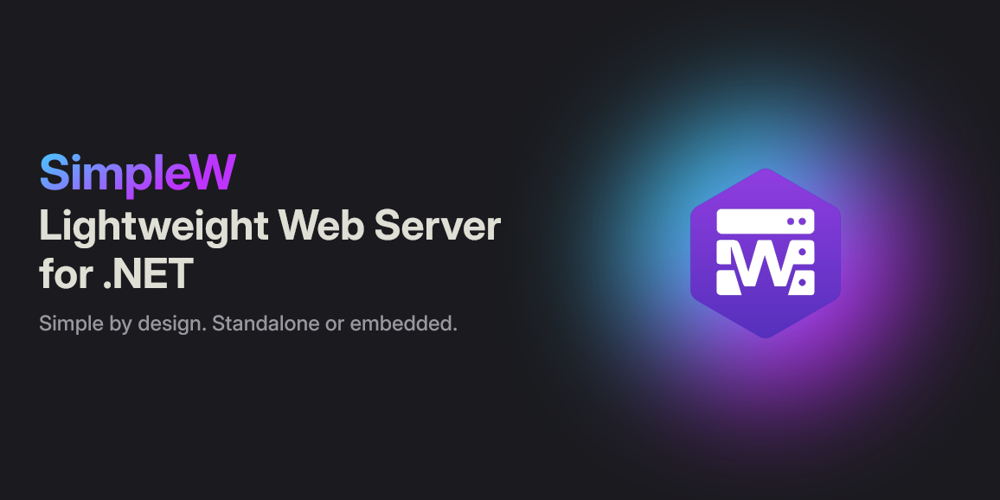

# SimpleW.Helper.NpmTooling

[](https://simplew.net)

[](https://github.com/Stratdev3/SimpleW/blob/master/licence)
[](https://www.nuget.org/packages/SimpleW.Helper.NpmTooling)
[](https://www.nuget.org/packages/SimpleW.Helper.NpmTooling)

<br/>
[](https://github.com/stratdev3/SimpleW/actions/workflows/build-linux.yml)
[](https://github.com/stratdev3/SimpleW/actions/workflows/build-macos.yml)
[](https://github.com/stratdev3/SimpleW/actions/workflows/build-windows.yml)

A SimpleW add-on for managing an npm frontend during development and serving its compiled files in production. The browser calls the SimpleW API directly. No API proxy or JavaScript integration plugin is required.

## Standalone usage

```csharp
using System.Net;
using SimpleW;
using SimpleW.Helper.NpmTooling;

var server = new SimpleWServer(IPAddress.Loopback, 8080);
server.MapGet("/api/hello", () => new { message = "Hello" });
server.UseNpmToolingModule(options => {
    options.Environment = "Development";
    options.ContentRootPath = System.IO.Directory.GetCurrentDirectory(); // Server project directory.
    options.Spa.SourcePath = "../client";
    options.Spa.DevelopmentUrl = "http://localhost:5173";
});
await server.RunAsync();
```

If no environment is specified explicitly, the module reads `DOTNET_ENVIRONMENT`, falling back to `Production`. Only `Development`, matched case-insensitively, enables npm. Call `UseNpmToolingModule` once, before starting the server. The IDE still launches the C# server, so backend breakpoints remain available.

Development prerequisites: Node >= 22.12 and npm, available on the IDE's PATH. The module targets .NET 8, 9 and 10 and SimpleW 26.1.x. It supports frontends that produce static files; it does not host a Node SSR server in production.

## API address

The module passes `VITE_SIMPLEW_API_URL` to the npm process, for example `http://127.0.0.1:8080/api`. The origin comes from the active SimpleW listener, or from `Spa.BackendUrl` when specified. `Spa.ApiPrefix` is appended to that origin. An address bound to all interfaces is replaced with a loopback address for local development.

In a SPA using Vite:

```js
const apiBaseUrl = import.meta.env.VITE_SIMPLEW_API_URL;
if (!apiBaseUrl) throw new Error('VITE_SIMPLEW_API_URL is missing.');
const response = await fetch(`${apiBaseUrl}/hello`);
```

Vite exposes this variable to client code natively. It is passed only to the child process, without changing the system environment or writing a configuration file. Other frontend tools can read this variable through their own configuration; the module does not require a plugin.

The development script must listen at the address configured in `DevelopmentUrl`. The module does not configure the script's port for it. Example Vite configuration:

```js
export default {
    server: { host: 'localhost', port: 5173, strictPort: true, open: false }
};
```

Keep any plugins required by the framework, such as `vue()`. Do not add an `/api` proxy for this integration. To use another port, update both the frontend server and `DevelopmentUrl`, or use `ScriptArguments` if the script accepts port arguments.

## Options

| Option | Default | Purpose |
| --- | --- | --- |
| `Environment` | DOTNET_ENVIRONMENT, otherwise Production | Select development or production |
| `ContentRootPath` | Current working directory | Base path for resolving the client directory |
| `Spa.SourcePath` | `../client` | Root directory containing package.json |
| `Spa.ProductionPath` | `wwwroot` | Absolute path or path relative to the executable directory |
| `Spa.DevelopmentUrl` | `http://localhost:5173` | HTTP(S) loopback origin, without credentials, subpath, query or fragment |
| `Spa.BackendUrl` | Listener origin | Explicit API origin override; required for a Unix socket |
| `Spa.ApiPrefix` | `/api` | REST prefix, CORS scope and exclusion from the SPA fallback |
| `Spa.Script` | `dev` | npm script to run |
| `Spa.ScriptArguments` | Empty list | Separate arguments after the npm `--` separator |
| `Spa.LaunchDevelopmentServer` | `true` | Start the frontend or wait for an external frontend |
| `Spa.EnableDevelopmentCors` | `true` | Install development CORS rules |
| `Spa.InstallDependencies` | `true` | Install missing direct dependencies |
| `Spa.OpenBrowser` | `true` | Open the frontend once it is available over HTTP |
| `Spa.StartupTimeout` | 60 seconds | Maximum wait for an HTTP 2xx response at the frontend root |
| `Spa.InstallTimeout` | 10 minutes | Dependency installation time limit |
| `Spa.NodePath` / `Spa.NpmCliPath` | Automatic discovery | Explicit paths for custom installations |
| `ServerLogger` / `ClientLogger` | SimpleW.Helper.NpmTooling.Server and .Client loggers | Separate supervision messages and npm output |

Configure options before installing the module; do not change them while it is running. npm stderr output is logged as warnings; process failures are logged by the supervisor.

### CORS

In development, the module allows only the exact `DevelopmentUrl` origin on `ApiPrefix`, using SimpleW's existing CORS module. Common REST requests and OPTIONS preflights are supported; allowed headers are `Content-Type, Authorization`. Credentials are disabled, and no wildcard origin is added.

If the application already configures CORS, set `EnableDevelopmentCors=false` and manage the rules in the application, particularly for cross-origin cookies. The module does not add CORS in production. It neither creates nor moves API routes: those remain defined by the application.

### Process supervision

If a direct dependency is missing from the client's `node_modules`, the module runs `npm ci --include=dev` when package-lock.json exists, or `npm install --include=dev` otherwise. Workspaces with packages hoisted to a parent directory can disable automatic installation. Changing a version in the manifest requires updating dependencies separately; detection checks their presence, not their versions.

The module invokes npm-cli.js through Node, without a shell, passing arguments separately. Its embedded supervisor monitors a pipe owned by the C# process. Windows also uses a Job Object; Unix uses a dedicated process group. Only processes created by the module are cleaned up, including when the debugger forcibly stops the backend. Processes are never terminated by program name or port number.

An HTTP server already responding at `DevelopmentUrl` is reported as a conflict. A probe timeout alone does not prevent startup: the script must reject an occupied port, for example with `strictPort=true` in Vite. HTTP availability does not identify a project. Without a private protocol, the module cannot verify the identity of a server that appears concurrently; the script remains responsible for handling port binding conflicts.

For a manually started frontend, set `LaunchDevelopmentServer=false`. In this mode, the module installs nothing, does not look for Node and does not start or terminate any frontend process. It waits for the URL, optionally opens the browser and monitors availability. The developer must supply `VITE_SIMPLEW_API_URL` when starting the frontend.

Installations and probes support cancellation. A failure leaves the backend available without automatically restarting the client. After correcting the problem, restart the server. Reloading a listener does not create a second frontend; changing the API origin requires a full restart to refresh the environment variable.

## Publishing

The package contains `buildTransitive` files that run only when publishing an executable, never during a regular build or IDE project load.

```xml
<PropertyGroup>
  <SimpleWNpmSourcePath>$(MSBuildProjectDirectory)/../client</SimpleWNpmSourcePath>
  <SimpleWNpmDistPath>$(SimpleWNpmSourcePath)/dist</SimpleWNpmDistPath>
  <SimpleWNpmBuildClient>true</SimpleWNpmBuildClient>
  <SimpleWNpmApiBaseUrl>/api</SimpleWNpmApiBaseUrl>
</PropertyGroup>
```

Publishing installs dependencies, then runs `npm run build` with `VITE_SIMPLEW_API_URL` set from `SimpleWNpmApiBaseUrl` and `NODE_ENV=production`. Vite embeds this value in the compiled JavaScript. `/api` uses the domain and port where SimpleW serves the application; an absolute URL can also be used for a separate deployment, with CORS configured in the application.

The dist files are added to the publish output under `wwwroot`, as external files even for a single-file publish. An npm failure or a missing dist/index.html fails publication. With `SimpleWNpmBuildClient=false`, npm is not called: a dist directory already built with the correct API address is required and copied unchanged.

MSBuild does not read C# runtime options. For a custom prefix, configure both `Spa.ApiPrefix` and `SimpleWNpmApiBaseUrl`. Likewise, keep `Spa.SourcePath` and `SimpleWNpmSourcePath` consistent. The legacy names `SimpleWStackSourcePath`, `SimpleWStackDistPath` and `SimpleWStackBuildClient` are accepted for migration; explicitly set new properties take precedence.

NuGet consumption imports the targets automatically. With ProjectReference, explicitly import `buildTransitive/SimpleW.Helper.NpmTooling.targets` into the executable project.

## Production

The module serves assets and reserves the index.html fallback for GET/HEAD navigation requests that accept HTML. API routes, missing assets and methods other than GET/HEAD do not become HTML pages. The public directory must contain index.html; links, junctions, path traversal and hidden paths are rejected. Keep assets immutable while serving them and publish to a clean output directory.

The module occupies the router's root fallback. Avoid another fallback or a global static route that would hide it. Vue routes containing a dot in their final segment do not receive the SPA fallback. Production requires neither Node, npm nor Vite.

## Validation to perform later

This extraction has been reviewed statically; no build, dotnet, test or npm commands were run. Before release, validate F5, AJAX requests and CORS preflights, custom prefixes and ports, an external frontend, an occupied port, installation cancellation, forced shutdown on Windows and Unix, publishing with the injected variable, publishing without npm and consuming the NuGet package in an independent application.
